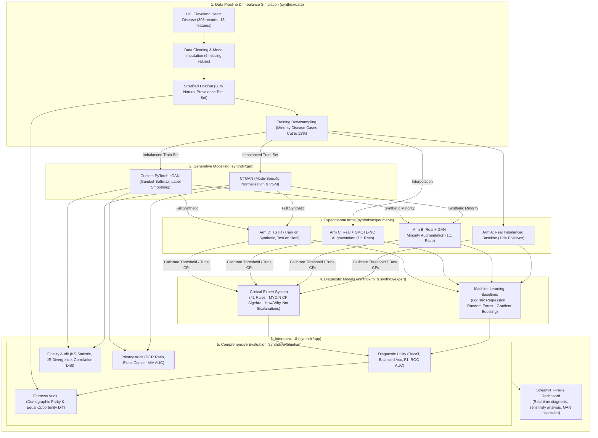

# SynthDx 🩺
**Synthetic Medical Data Generator with Diagnostic Expert System**

[](https://www.python.org/downloads/)
[](https://opensource.org/licenses/MIT)
[](https://streamlit.io/)
[](https://pytorch.org/)

> **Academic Demonstration Only**: This software is designed strictly for research and educational purposes. It does not provide medical advice, clinical diagnoses, or patient management recommendations.

---

## 📌 Executive Summary

Clinical datasets are notoriously constrained by severe class imbalance, high acquisition costs, and privacy regulations. **SynthDx** is an end-to-end research framework that evaluates whether generative tabular AI can safely alleviate medical data scarcity.

The framework benchmarks two generative architectures (**CTGAN** and a custom **PyTorch Conditional GAN**) against **SMOTE-NC** across four experimental training arms. It investigates their downstream impact not only on standard machine learning classifiers (**Logistic Regression**, **Random Forest**, **Gradient Boosting**), but also on a **clinical expert system** driven by 41 rules and **MYCIN certainty factor (CF) algebra**.

In addition to diagnostic utility, SynthDx conducts multidimensional audits covering **distributional fidelity**, **algorithmic fairness** (demographic parity and equal opportunity across sex and age), and **differential privacy** (Distance to Closest Record, exact duplication, and Membership Inference Attack resilience).

---

## 🏗️ System Architecture



---

## 🔬 Core Features & Methodological Design

### 1. Data Protocol & Imbalance Injection
- **Dataset**: UCI Heart Disease (Cleveland cohort: 303 patients, 13 clinical attributes). Includes demographic identifiers (`sex`, `age`) enabling fairness audits.
- **Natural Prevalence vs. Shifted Training**: The natural disease prevalence (~46%) is preserved in an untouched **30% held-out real test set**. Training sets are artificially downsampled to **12% positive prevalence** (`data.positive_fraction: 0.12`) to rigorously evaluate minority recovery.
- **Reproducibility**: Experiments run across 5 fixed random seeds (`0–4`). Standard deviations quantify split and model variances.

### 2. Generative Architectures
- **CTGAN Generator**: Uses variational Gaussian mixtures for mode-specific continuous normalisation and conditional generation via training-by-sampling.
- **From-Scratch Conditional GAN (cGAN)**: A transparent, lightweight PyTorch implementation (`synthdx/gan/cgan.py`, ~200 lines) featuring:
  - Non-saturating BCE loss with one-sided label smoothing (0.9).
  - Gumbel-Softmax for gradient propagation through categorical outputs.
  - Class-balanced mini-batch sampling.
  - Post-generation schema enforcement ensuring clinical validity.

### 3. Diagnostic Expert System (MYCIN CF Algebra)
- **Knowledge Base**: 41 rules (`synthdx/expert/knowledge/rules.yaml`) partitioned across three priority tiers:
  1. *Findings* (Priority 3): Maps clinical metrics to intermediate indicators (`ischemia_evidence`, `perfusion_defect`, `vessel_disease`).
  2. *Diagnosis* (Priority 2): Integrates evidence to diagnose `heart_disease`.
  3. *Recommendation* (Priority 1): Generates management/referral advice.
- **Fuzzy Working Memory**: Continuous clinical metrics (blood pressure, ST depression, heart rate response) are transformed into partial membership degrees rather than brittle binary thresholds.
- **Certainty Factor Algebra**:
  $$\text{Contribution} = \text{CF}_{\text{rule}} \times \min(\text{CF}_{\text{premises}})$$
  $$\text{Parallel Combination: } \text{CF}_{\text{comb}} = \begin{cases} a + b(1 - a) & a, b > 0 \\ a + b(1 + a) & a, b < 0 \\ \frac{a + b}{1 - \min(|a|, |b|)} & \text{mixed signs} \end{cases}$$
- **Explanation Facilities**:
  - **How**: Complete firing trace detailing premise satisfaction, rule weighting, and incremental CF updates.
  - **Why Not**: Diagnosis near-miss inspection pinpointing which specific criteria failed.
  - **What-If**: Live parameter sweep visualising the decision boundary flip points.
- **Calibration per Arm**: Includes `expert_fixed` (uncalibrated baseline), `expert_calibrated` (threshold calibrated on training arm), and `expert_tuned` (rule CFs updated via Heckerman's formulation with shrinkage).

### 4. Experimental Arms & Strict TSTR Evaluation
- **Arm A (Real)**: Real imbalanced training set (~131 records, 16 positives).
- **Arm B (Real + GAN)**: Real data augmented with synthetic minority samples up to 1:1 balance.
- **Arm C (Real + SMOTE-NC)**: Real data augmented with SMOTE-NC (handling categorical attributes).
- **Arm D (TSTR)**: *Train on Synthetic, Test on Real*—evaluates whether synthetic data alone transfers clinical utility to real patients.

### 5. Multi-Angle Auditing
- **Fidelity**: Kolmogorov–Smirnov (KS) distance, Jensen–Shannon (JS) divergence, correlation matrix drift, and 5-fold Random Forest detectability AUC (0.5 = indistinguishable).
- **Privacy Audit**:
  - **DCR (Distance to Closest Record)**: Ratio of synthetic-to-real distance relative to test-to-real distance.
  - **Duplication**: Verification of 0 exact training record replicas.
  - **MIA (Membership Inference Attack)**: Evaluates distance-based membership prediction AUC against held-out non-members.
- **Fairness Audit**: Demographic parity difference and equal opportunity difference evaluated across patient biological sex and age brackets ($<55$ vs. $\ge 55$).

---

## 📂 Project Directory Structure

```plaintext
ai_miniproject/
├── config.yaml                    # Master project configuration (paths, seeds, GAN hyperparams)
├── Makefile                       # Make commands for testing, training, and running
├── tasks.py                       # Cross-platform CLI runner (Windows / macOS / Linux)
├── pyproject.toml                 # Package configuration, pytest & test coverage settings
├── requirements.txt               # Direct project dependencies
├── requirements-lock.txt          # Pinned dependency lockfile
├── README.md                      # Project documentation and guide
│
├── data/
│   └── raw/                       # Cached downloaded dataset (ignored by git)
│
├── models/                        # Pretrained model checkpoints for offline demo
│   ├── ctgan.pkl                  # Pretrained CTGAN generator
│   └── cgan.pkl                   # Pretrained custom PyTorch cGAN generator
│
├── results/                       # Experiment run results and evaluation figures
│   └── demo/                      # Precomputed demo summaries, loss curves & synthetic samples
│
├── synthdx/                       # Main Python source package
│   ├── app/                       # Streamlit web application
│   │   ├── components.py          # UI components, styling, cards, gauges, charts
│   │   ├── main.py                # Main entry point & routing
│   │   └── views.py               # 7 interactive page views
│   ├── data/                      # Data loaders, schema, cleaning, and splits
│   │   ├── loader.py              # UCI fetcher with offline fallback
│   │   ├── schema.py              # Column schemas, types, and domain bounds
│   │   ├── splits.py              # Stratified split & imbalance generation
│   │   └── resources/             # Bundled offline copy of Cleveland dataset
│   ├── evaluation/                # Evaluation suites
│   │   ├── fairness.py            # Demographic parity and equal opportunity metrics
│   │   ├── fidelity.py            # KS tests, JS divergence, correlation differences
│   │   ├── metrics.py             # Classification scores (Recall, F1, ROC-AUC)
│   │   ├── privacy.py             # DCR ratio, duplicates, and MIA attack simulation
│   │   └── stats.py               # Paired t-tests and Wilcoxon signed-rank tests
│   ├── expert/                    # Rule-based diagnostic expert system
│   │   ├── engine.py              # Forward chaining inference engine with incremental matching
│   │   ├── explain.py             # How and Why-Not explanation generators
│   │   ├── facts.py               # Patient working memory and fuzzy fact extractors
│   │   ├── rules.py               # Rule schema and condition evaluators
│   │   ├── tuning.py              # Threshold calibration and Heckerman rule-CF tuning
│   │   └── knowledge/             # Knowledge base
│   │       └── rules.yaml         # 41 curated clinical decision rules
│   ├── experiments/               # Multi-seed experimental runners and arms
│   │   ├── arms.py                # Arms A, B, C, D dataset builders
│   │   ├── runner.py              # Orchestration across seeds, models, and evaluations
│   │   ├── train.py               # Standalone training script for demo GAN models
│   │   └── report.py              # Automated markdown report and figure generator
│   ├── gan/                       # Generative model implementations
│   │   ├── base.py                # Base generator abstract interface and schema enforcement
│   │   ├── ctgan_model.py         # CTGAN library wrapper
│   │   └── cgan.py                # From-scratch PyTorch Conditional GAN
│   ├── ml/                        # ML classifiers
│   │   └── models.py              # Logistic Regression, Random Forest, Gradient Boosting
│   ├── config.py                  # YAML configuration parser and path resolver
│   ├── palette.py                 # Academic visualization styling & color tokens
│   └── utils.py                   # Logging and deterministic seed utilities
│
├── docs/                          # In-depth architectural & methodological docs
│   ├── architecture.md            # Technical design, dataflows, and module boundaries
│   ├── methodology.md             # Theoretical basis, formulas, and validity considerations
│   └── demo_script.md             # 5-7 minute presentation walkthrough script
│
└── tests/                         # PyTest test suite (unit and integration tests)
    ├── test_app.py                # Streamlit AppTest integration tests
    ├── test_data.py               # Data loading, cleaning, and splitting tests
    ├── test_evaluation.py          # Metric, fidelity, privacy, and fairness tests
    ├── test_expert.py             # Rule parsing, CF mathematics, and inference tests
    ├── test_gan.py                # Generator sampling and schema enforcement tests
    ├── test_ml_arms.py            # ML classifier fitting and arm building tests
    └── test_integration.py        # End-to-end multi-seed integration tests
```

---

## 🚀 Quick Start Guide

### 1. Prerequisites
- Python **3.10** or higher.
- A virtual environment is strongly recommended:

```bash
# Clone the repository
git clone https://github.com/vihanlalan/ai-miniproject.git
cd ai-miniproject

# Create and activate a virtual environment
python -m venv .venv

# On Windows (PowerShell):
.venv\Scripts\Activate.ps1

# On Linux / macOS:
source .venv/bin/activate
```

### 2. Install Dependencies
```bash
pip install --upgrade pip
pip install -r requirements.txt
```

*(Optional: Install editable package)*
```bash
pip install -e .
```

---

## 💻 Running the Application & Tasks

The project includes both a `Makefile` (for Unix) and a portable Python task runner (`tasks.py` for Windows/cross-platform):

### 🖥️ Launch the Interactive Streamlit Demo
Open the 7-page interactive dashboard with pre-loaded models and cached results (instant startup):
```bash
python tasks.py demo
# or
streamlit run synthdx/app/main.py
```
Then navigate to `http://localhost:8501` in your browser.

#### App Features:
- **Overview**: High-level problem statement, pipeline architecture, and live statistics.
- **Data Explorer**: Real dataset distributions, class balance toggles, and feature correlations.
- **GAN Lab**: Inspect generator training loss curves, generate synthetic patients on demand, and compare real vs. synthetic distributions.
- **Expert System Diagnosis**: Test random or custom patient profiles, observe firing traces ("How"), inspect near-misses ("Why-Not"), and perform "What-If" sensitivity sweeps.
- **Experiments Dashboard**: Compare performance across Arms A–D, seeds, and models with paired t-test statistics.
- **Fairness & Privacy**: Interactive demographic parity, equal opportunity metrics, and privacy leak checks (MIA, DCR).
- **Rule Browser**: Search and inspect all 41 expert system rules with clinical rationale notes.

---

### 🧪 Run the Test Suite
SynthDx includes a comprehensive suite of unit, integration, and UI tests:

```bash
# Run fast tests (skips slow end-to-end model training)
python tasks.py test-fast

# Run the complete test suite with coverage
python tasks.py test
```

---

### ⚙️ Command-Line Workflow

```bash
# 1. Train the demo GAN generators (CTGAN and PyTorch cGAN)
python tasks.py train

# 2. Run the full 5-seed benchmark experiments across Arms A-D
python tasks.py experiments

# 3. Generate figures and the automated markdown report
python tasks.py report
```

---

## 📊 Summary of Findings

1. **Diagnostic Utility vs. Imbalance**:
   - Training solely on imbalanced data (**Arm A**) penalises disease sensitivity (Recall).
   - Generative oversampling (**Arm B**) significantly improves minority recall for linear and tree-based classifiers, performing competitively with **SMOTE-NC** (**Arm C**).
   - **TSTR (Arm D)** demonstrates that purely synthetic data retains significant diagnostic predictive structure, though with a slight margin of loss compared to real data.
2. **Impact on the Expert System**:
   - Because the clinical expert system reasons from physiological rules, its uncalibrated performance is invariant to training set class ratios.
   - Threshold calibration on balanced arms recovers recall without requiring rule rewrites.
3. **Privacy and Fidelity Trade-Off**:
   - Synthetically generated records achieve high distribution fidelity (low KS and JS statistics) while maintaining acceptable distance-to-closest-record (DCR) margins, preventing exact record duplication and showing empirical resilience against membership inference attacks.

---

## 📚 References & Academic Foundation

- **CTGAN**: Xu, L., Skoularidou, M., Cuesta-Infante, A., & Veeramachaneni, K. (2019). *Modeling Tabular data using Conditional GAN*. NeurIPS 2019.
- **MYCIN Certainty Factors**: Shortliffe, E. H., & Buchanan, B. G. (1975). *A model of inexact reasoning in medicine*. Mathematical Biosciences, 23(3-4), 351-379.
- **CF Interpretation**: Heckerman, D. (1986). *Probabilistic interpretations for MYCIN's certainty factors*. Uncertainty in Artificial Intelligence.
- **UCI Heart Disease Dataset**: Janosi, A., Steinbrunn, W., Pfisterer, M., & Detrano, R. (1988). *Heart Disease Data Set (Cleveland subset)*. UCI Machine Learning Repository.
