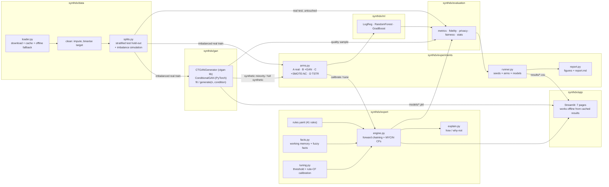

# Architecture

## Module responsibilities

| Package | Responsibility | Key entry points |
|---|---|---|
| `synthdx.data` | load, clean, split, imbalance | `load_heart_disease`, `prepare_splits` |
| `synthdx.gan` | synthetic data generators | `CTGANGenerator`, `ConditionalGAN`, `build_generator` |
| `synthdx.expert` | rule-based diagnosis | `InferenceEngine.diagnose`, `format_report`, `fit_expert` |
| `synthdx.ml` | baseline classifiers | `train_classifier`, `predict_scores` |
| `synthdx.evaluation` | all metrics | `classification_metrics`, `fidelity_summary`, `privacy_summary`, `group_metrics` |
| `synthdx.experiments` | orchestration and reporting | `run_experiments`, `generate_report`, `train_demo_models` |
| `synthdx.app` | user interface | `streamlit run synthdx/app/main.py` |

All randomness flows from explicit seeds (`synthdx.utils.set_seed`, per-model
`random_state`, a private RNG inside each generator). All settings live in
`config.yaml`.
